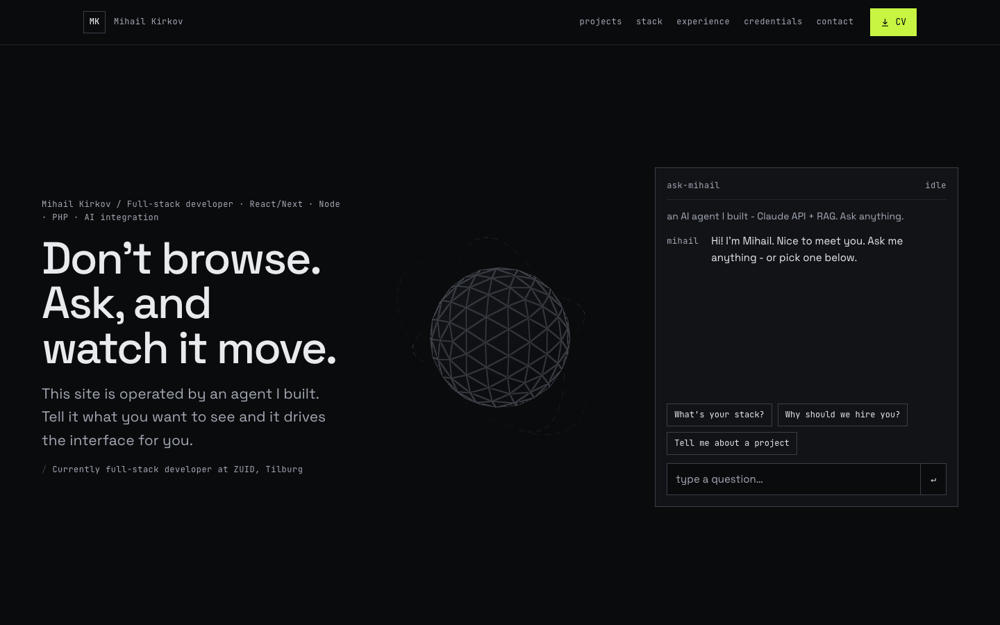
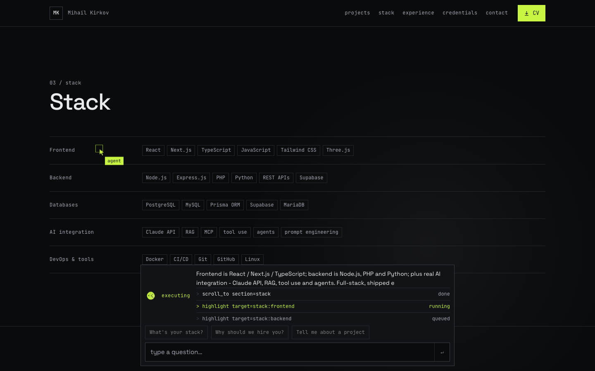
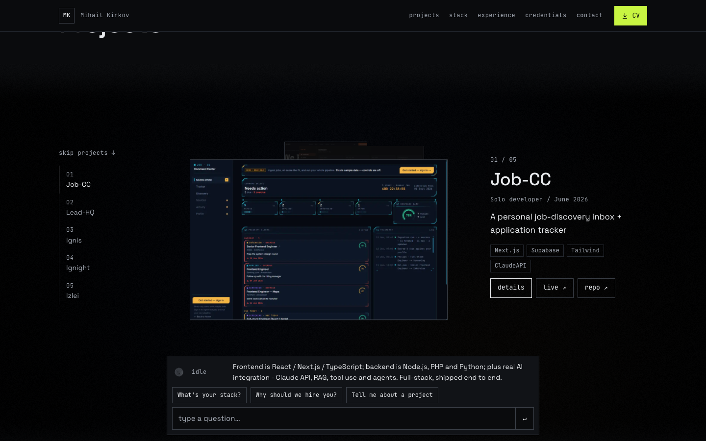
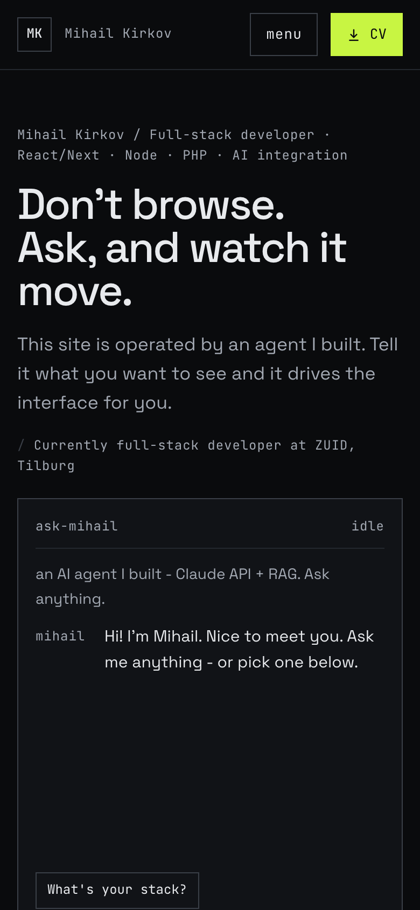

# Mihail Kirkov - Portfolio

A portfolio operated by an AI agent. You type a request; the agent answers and
drives the page with a visible cursor while it does: it scrolls to a section,
opens a project, points at a skill group, opens a gallery.

**Live:** https://portfolio-mihail.vercel.app/



## What you see

- **Boot intro.** On the first visit of a session, four role cursors (layout,
  copy, media, style) assemble the real hero from a grey wireframe, then merge
  into the one accent agent cursor. Any click, key or scroll ends it.
- **The agent.** A command bar in the hero, docked to the bottom of the screen
  everywhere else. Three suggestion chips, free-typed questions, a tool-call
  log that shows each action as it runs, and a "Show me" button that replays
  actions you interrupted.
- **The core.** A shader sphere (React Three Fiber) that reacts to the agent's
  state (idle, thinking, executing) and travels into the docked bar.
- **Projects** as scroll-driven depth chapters on a WebGL stage, with a detail
  overlay and a full-screen gallery.
- **Stack** as a constellation (a tiered list on phones and reduced motion).
- **Experience** as a journey through one gate per career step: About first
  (with the competitive record, languages and education), then roles,
  milestones and certifications. The vertical timeline is the fallback.
- **Contact** as a finale with the CV, email, GitHub and LinkedIn.







## The agent and its tool calls

The agent can only do what a small, closed action registry allows
(`lib/agent/schema.ts`, browser side in `lib/agent/actions.ts`):

| Action | What it does |
| --- | --- |
| `scroll_to(section)` | Scroll to a section |
| `open_project(slug)` | Bring a project to the front and open its detail |
| `highlight(target)` | Outline a section, project, skill group, experience entry or CTA |
| `filter_projects(tag)` | Dim projects whose stack does not list the tag |
| `show_gallery(slug)` | Open a project's screenshots |
| `offer_cv()` | Point at the CV button (never downloads anything) |
| `offer_contact()` | Scroll to contact and point at the email link |

Every enum (sections, slugs, tags, targets) is generated from
`content/seed.json`, so the model cannot name something that is not on the
page. Each action is sent to Claude as a tool; the tools are UI directives
only: nothing runs on the server and there is no tool-result round trip.

In the browser each accepted call becomes cursor steps: fly to the target,
click, then run the effect. At most four actions per reply. Each finished
action is announced to screen readers through a live region.

## Architecture

- **Static content.** `content/seed.json` is the only content source. The page
  is prerendered at build time; there is no database or runtime fetch. The
  chat's system prompt is built from the same file.
- **Validated actions.** A tool call is accepted only if its input arrived as
  complete JSON, names a registered action and uses only allowed values. It is
  validated twice: in the route as the stream arrives, and again in the
  browser before anything moves.
- **NDJSON stream.** `/api/chat` answers with one JSON event per line:
  `{"t":"text"}` deltas, `{"t":"action"}` the moment each tool call closes,
  and `{"t":"done"}` last, always, including after an error or truncation. The
  model calls its actions first and sends the answer through a final `say`
  tool, so the page starts moving while the answer is still being written
  (`lib/agent/chat-stream.ts`).
- **Guards.** Server-side API key, 500-character input cap, last 10 messages
  of history, 450 output tokens, 10 requests per minute per IP (in-memory, per
  instance), and a plain failure message if anything goes wrong.
- **Fallbacks.** The page is complete HTML underneath every animation:
  - JS off: all content readable, all links work.
  - Reduced motion: no intro, no cursor flights, no 3D; actions still happen,
    instantly.
  - No WebGL, low-end devices, phones: a server-rendered SVG still of the core.
  - Under 768px: projects as plain cards with the same content.
  - No API key or an outage: the three chips still answer, from canned
    replies with scripted actions, with zero network.

## Stack

Next.js 15 (App Router), React 19, TypeScript, Tailwind 4, React Three Fiber,
Lenis, Claude API (`claude-haiku-4-5`) via `@anthropic-ai/sdk`. Hosted on
Vercel.

## Run it

```bash
npm install
npm run dev          # http://localhost:3000
```

`.env.local`:

```bash
ANTHROPIC_API_KEY=      # server only; enables free-typed questions
NEXT_PUBLIC_SITE_URL=   # canonical URL, for metadata, sitemap and the share image
```

Both are optional locally: without the key, the chips still work and typed
questions get the chat's failure message.

Checks. The intro, core and dock tests drive Chrome against a production
build: run `npm run build` first and they start their own server, or set
`INTRO_URL` to one that is already running.

```bash
npm run lint
npm run build
npm run test:chat     # stream parsing, validation, truncation, errors
npm run test:choreo   # cursor engine and action runner
npm run test:intro    # boot intro timing and behaviour
npm run test:core     # core travel and docking
npm run test:dock     # docked bar on 320-390px phones
npm run test:finale   # contact finale: images, skills, dock hides and returns
```

Content: edit `content/seed.json`. The page, the agent's enums and its system
prompt all rebuild from it.

## Links

- GitHub: https://github.com/MihailKirkov
- LinkedIn: https://www.linkedin.com/in/mihail-kirkov-b65b36262/
